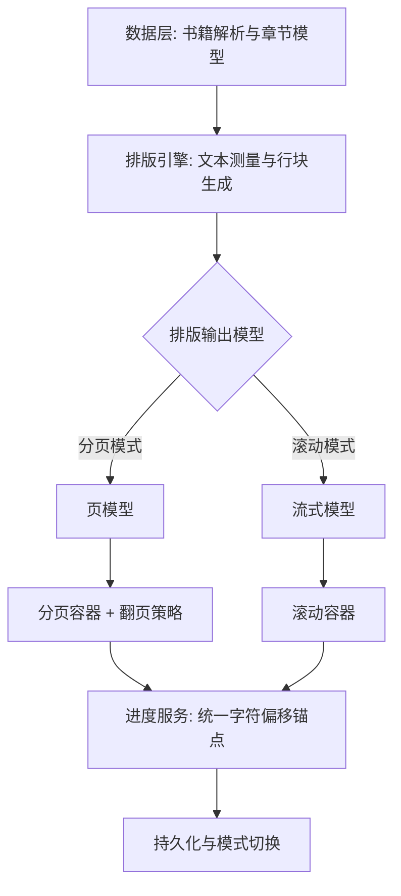

# iReader · 墨阅

> 一个运行在 **HarmonyOS NEXT** 上的本地电子书阅读器，使用 **ArkTS + ArkUI（Stage 模型 / V2 状态管理）** 自研，零第三方依赖。
> 主打大文件不卡顿、TXT / EPUB / 图片包统一阅读内核，以及可定制的阅读主题与 App 皮肤。

---

## ✨ 功能特性

- **多格式导入**：支持 `TXT`、`EPUB`（自动抽取正文）、`ZIP` 图片包；支持文件夹批量导入，自动按文件夹分组。
- **内容指纹查重**：导入时按内容哈希去重，跳过已存在的书籍，避免重复入库。
- **两种内容类型，一套阅读内核**
  - **文本书（TXT / EPUB）**：按章节切分、逐章落盘，10MB 级大书也不爆内存。
  - **图片书（ZIP）**：解压后按目录成章，支持整图浏览。
- **三种翻页模式**
  - 上下连续卷轴（默认，手势分区翻屏）
  - 左右分页（Swiper 跨章页窗口 + 章级分页缓存）
  - 仿真翻页（手势接管 + Canvas 整页折纸绘制）
- **阅读设置**：字号（14–30）、行距、阅读主题（护眼 / 白底 / 深色 / 随系统）、阅读方向（文本与图片书各自独立记忆）。
- **目录 / 书签 / 全文搜索**：目录按 30 章分档筛选并自动定位当前章；书签记录章 + 偏移；全文搜索逐章扫描、命中高亮、上限 200 处。
- **划线 / 想法（笔记）**：长按选词可复制 / 划线 / 写想法 / 查词；笔记独立详情页按三组查看，支持导出想法为 Markdown。
- **「我的」页统计**：阅读时长、连续天数、13 周热力图、书架概览、笔记聚合，全部由本地 JSON 派生。
- **双主题体系（互不干扰）**
  - 阅读主题：只作用于阅读页正文与面板。
  - App 皮肤：金棕 / 喜庆红 / 深黑 / 天蓝，作用于书架 / 发现 / 我的 / 书卡，各有亮暗变体。
- **数据备份与导出**：可将书架元数据、设置、统计、书签、划线、App 皮肤导出为 JSON（不含书籍正文与图片）。
- **可访问性**：内置 `MotionTokens` 动效令牌，支持「减弱动效」。

---

## 🧱 技术架构

采用「**一套阅读内核 + 两类内容容器 + 三个翻页策略**」的分层设计：三种模式在书籍解析、文本测量、排版、主题、进度管理上高度一致，差异仅集中在排版输出模型与手势→视觉映射两处。



进度统一以 **「章节 + 章内字符偏移」** 作为锚点，任何翻页模式都能无损换算，切换模式不丢进度。

完整的模块划分、数据模型、导入链路、渲染窗口算法、性能与内存模型、关键不变量请阅读：

- [`docs/ARCHITECTURE.md`](docs/ARCHITECTURE.md) — 代码真实结构与改动点索引
- [`docs/harmonyOS_reader.md`](docs/harmonyOS_reader.md) — 翻页架构设计文档

---

## 📦 环境要求

| 项 | 版本 |
|---|---|
| DevEco Studio | 配套 HarmonyOS NEXT 的版本（推荐最新） |
| HarmonyOS SDK | `6.1.1(24)`，API 24 |
| 构建工具 | hvigor（`assembleHap`），安装通过 hdc |
| 设备 / 模拟器 | 手机（`phone`），HarmonyOS NEXT 真机或模拟器 |

> 应用 `bundleName` 为 `com.example.ireader`，`deviceTypes` 仅含 `phone`。

---

## 🛠 构建与运行

### 方式一：DevEco Studio（推荐）

1. 用 DevEco Studio 打开本工程根目录。
2. **配置签名**：`File → Project Structure → Signing Configs → 勾选 Automatically generate signature`，由 IDE 自动生成本机证书并填入 `build-profile.json5`。
3. 连接真机或启动模拟器，点击 **Run**（或 `hvigor → assembleHap`）。

### 方式二：命令行（hvigor）

```bash
# 在工程根目录设置 SDK 环境变量并构建 debug HAP
export DEVECO_SDK_HOME="<DevEco Studio>/sdk"
node "<DevEco Studio>/tools/hvigor/bin/hvigorw.js" \
  assembleHap --mode module -p product=default -p buildMode=debug --no-daemon

# 产物路径
entry/build/default/outputs/default/entry-default-signed.hap

# 安装到已连接的设备（无线调试需先 hdc tconn <ip:port>）
hdc install -r entry/build/default/outputs/default/entry-default-signed.hap

# 启动应用
hdc shell "aa start -a EntryAbility -b com.example.ireader"
```

### 签名配置（不入仓）

真实签名含证书路径与明文密码，**绝不能提交**。仓库已提供模板：

```bash
cp build-profile.json5.example build-profile.json5   # 该文件已被 .gitignore 排除
```

或直接用 DevEco Studio 自动签名（见方式一）。

---

## 📁 目录结构（核心）

```
ireader/
├── AppScope/                       # 应用级配置（app.json5）
├── docs/                           # 架构 / 设计文档（ARCHITECTURE.md、harmonyOS_reader.md）
├── entry/src/main/ets/
│   ├── pages/                      # Index(书架) / Reader(阅读页) / Profile(我的) / Notes / GroupBooks
│   ├── reader/                     # Engine/Strategy 层：PageWindow、BlockWindow、FlipStateMachine、LayoutConfig
│   ├── model/                      # 领域模型、AppEnv 全局环境、Annotation、ShelfTheme、ReaderTheme
│   ├── service/                    # 导入 / 解析 / 分页 / 存储 / 备份 / 统计
│   │   ├── ImportService.ets       # TXT / EPUB / ZIP 导入入口
│   │   ├── TxtImportTask.ets      # @Concurrent 后台解析任务
│   │   ├── EpubParser.ets         # EPUB 解包与正文抽取
│   │   ├── TextPaginator.ets      # 单章分页（探针标定 + 字宽模型 + 单页校验）
│   │   ├── LibraryStore.ets       # 书架 / 设置 / 书签 JSON 读写
│   │   └── BackupService.ets      # 阅读数据导出
│   ├── components/                 # 书架卡片、发现页、我的页、阅读器渲染组件
│   ├── theme/                      # 阅读主题 + App 皮肤（skins: 金棕/喜庆红/深黑/天蓝）
│   └── utils/                      # AppPaths / FileUtil / NaturalSort
└── entry/src/main/resources/rawfile/fonts/   # 内置开源字体 + LICENSE.txt
```

更细的目录职责见 [`docs/ARCHITECTURE.md §3 目录结构`](docs/ARCHITECTURE.md)。

---

## 💾 数据存储（沙箱 `filesDir`）

全部数据以沙箱 JSON 文件持久化（无 Preferences、无数据库）：

```
filesDir/
├── library.json            # 书架元数据（按最近打开倒序）
├── settings.json           # 阅读设置（字号 / 行距 / 主题 / 阅读方向）
├── app_appearance.json     # App 皮肤（独立于阅读器设置）
├── reading_stats.json      # 阅读时长统计
├── bookmarks/{bookId}.json # 书签
├── annotations/{bookId}.json # 划线 / 想法
├── search/{bookId}.json    # 全文搜索历史
└── books/{bookId}/         # 每本书：manifest.json + text/ 或 content/ + 原始包
```

正文**不内联**在元数据中，只存「文件路径 + 字符数」，按章从磁盘读取 —— 这是大文件不爆内存的前提。

---

## 🔤 第三方字体与许可

应用内置 6 款开源中文字体（位于 `entry/src/main/resources/rawfile/fonts/`），均基于 **SIL Open Font License 1.1 (OFL-1.1)** 分发：

| 字体 | 版权方 |
|---|---|
| noto-sans-sc.otf | © 2014–2021 Adobe |
| noto-serif-sc.otf | © 2017–2024 Adobe |
| lxgw-wenkai.ttf | © 2021–2026 LXGW |
| ma-shan-zheng.ttf | © 2018 The Ma Shan Zheng Project Authors |
| zcool-kuaile.ttf | © 2018 The ZCOOL KuaiLe Project Authors |
| zcool-xiaowei.ttf | © 2018 The ZCOOL XiaoWei Project Authors |

完整许可文本与各字体版权声明见 [`entry/src/main/resources/rawfile/fonts/LICENSE.txt`](entry/src/main/resources/rawfile/fonts/LICENSE.txt)，根目录 [`NOTICE`](NOTICE) 亦作汇总说明。OFL 要求字体本身不得改用其他许可证分发。

---

## 📄 许可证

本项目代码以 **Apache License 2.0** 开源，详见 [`LICENSE`](LICENSE)。

- 代码：`Apache-2.0`
- 内置字体：`SIL Open Font License 1.1`（独立授权，见上）

---

## 🗺 后续规划

按收益 / 风险排序（详见 [`docs/ARCHITECTURE.md §14`](docs/ARCHITECTURE.md)）：

- **正确性**：图片书竖排改为视口中心判定；跨窗口跳转遮挡时长可观测化。
- **性能**：导入改为流式分块解码；分页结果按「宽高｜字号｜行距」落盘缓存，跨会话复用；章节缓存按字节预算淘汰。
- **体验**：进度改为按字符数加权；左右模式支持「章首 / 章末」直达；竖排加滚动条 / 进度指示器。
- **工程化**：统一 hilog domain/tag；抽出纯 TS 的 `ReaderEngine` 便于单测；补解析 / 分页用例。

---

## 🙏 致谢

感谢上述开源中文字体项目与 HarmonyOS / OpenHarmony 社区。
