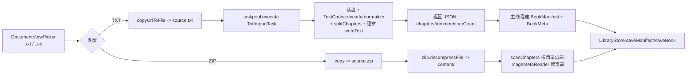
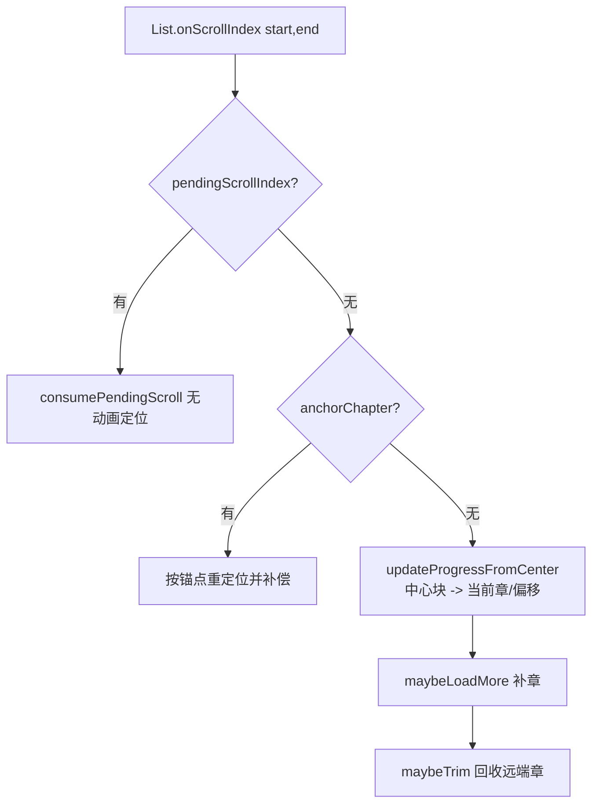

# ireader 核心架构

> 本文档描述当前代码的真实结构（HarmonyOS Stage 模型 / ArkTS），用于后续迭代时快速定位改动点。
> 与代码不一致时以代码为准，改动后请同步更新本文档。

## 1. 产品形态

一个本地 TXT / 图片（ZIP）阅读器，书架式多书管理：

- **TXT 书**：导入后按章节切分、逐章落盘；支持上下连续卷轴与左右分页两种模式。
- **图片书**：ZIP 解压后按目录成章，支持上下连续滚动（图片流）与左右翻页（一图一页），竖排支持双指缩放。

两种模式共享同一套 `ChapterMeta` 元数据与 `ReadingProgress` 进度模型，渲染层是两套独立容器。

## 2. 技术栈与约束

| 项 | 选择 |
|---|---|
| UI | ArkUI 声明式，Stage 模型，单 Ability（`EntryAbility`） |
| 构建 | hvigor（`assembleHap`），hdc 安装 |
| 状态 | 组件内 `@State`/`@Prop` + `@StorageProp`（仅 `systemColorMode`、`appActive`） |
| 持久化 | 沙箱 JSON 文件（无 Preferences、无数据库） |
| 文本解码 | `TextCodec`（BOM / UTF-8 / GBK 探测） |
| 大文件解析 | `taskpool` + `@Concurrent`（`TxtImportTask`） |
| 分页测量 | `UIContext.getMeasureUtils().measureTextSize`：探针标定字宽/行高 + 字宽模型推算页边界 + 单页实测校验 |
| 第三方依赖 | 无 |

ArkTS 硬约束（踩过的坑）：

- 变量必须显式类型，禁止隐式 `any`。
- `static` 方法内不能用 `this`。
- 不支持 `Function.prototype.apply/call`。
- 读文本用 `util.TextDecoder`，禁用 `String.fromCharCode.apply`。
- `@Concurrent` 函数只能引用 import 的符号或局部变量（不能在 worker 里调用同文件的私有函数）。
- taskpool 参数/返回值必须可序列化，**不能传自定义 class 实例、不能传 Context**。

## 3. 目录结构

```
entry/src/main/ets/
├── model/
│   ├── BookModels.ets        # 全部领域模型与枚举（BookType / ReadingMode /
│   │                         #   ReadingProgress / BookMeta / ChapterMeta / ImageEntry / BookManifest /
│   │                         #   Bookmark / ReaderSettings / SearchHit / ImportResult / ImportProgressCallback）
│   ├── Annotation.ets        # 划线/想法模型（Annotation）+ 渲染片段切分（SegmentBuilder）
│   ├── ReaderTheme.ets       # ReadingTheme 枚举 + ReaderThemeColors 三套配色
│   └── ReadingStats.ets      # 阅读时长统计模型
├── service/
│   ├── ImportService.ets     # importTxt（走 taskpool）/ importZip（解压 + 扫描）
│   ├── TxtImportTask.ets     # @Concurrent 解析任务：读盘 → 解码 → 切分 → 逐章写盘 → 返回 JSON
│   ├── TextCodec.ets         # 编码识别 + 章节切分（decode / normalize / splitChapters）
│   ├── TextPaginator.ets     # 单章分页（PaginationSession 可分批推进：探针标定 + 字宽模型 + 单页校验）
│   ├── ImageMetaReader.ets   # 读取图片宽高，产出 ImageEntry
│   ├── AnnotationStore.ets   # 划线/想法的逐书 JSON 读写与查找
│   ├── LibraryStore.ets      # 书架/清单/设置/书签的 JSON 读写
│   ├── ReadingStatsStore.ets # 阅读时长累计（日期键 / clear）
│   ├── ProfileStats.ets      # 「我的」页派生统计：连续天数 / 13 周热力图 / 书架概览
│   └── (无 EdgeTurnTracker —— 已删除)
├── components/
│   ├── BookCard.ets          # 书架卡片
│   ├── DiscoverPanel.ets     # 发现页占位
│   ├── ProfilePanel.ets      # 「我的」页：时长 / 继续阅读 / 习惯统计 / 13 周热力图 / 设置区
│   └── reader/
│       ├── TextReaderView.ets   # 文本书：竖排块窗口 + 左右页窗口
│       ├── ImageReaderView.ets  # 图片书：竖排图片块窗口 + 左右图片页窗口
│       ├── ImageDataSource.ets  # ImagePage + 跨章图片页数据源
│       └── ReaderPanels.ets     # 目录（书名 + 目录/笔记 tab + 30 章分档）/ 书签 / 阅读设置 / 全文搜索
├── pages/
│   ├── Index.ets             # 书架首页 + 导入入口 + 三 Tab
│   ├── Reader.ets            # 阅读页壳：加载、切章、进度、遮挡、模式切换
│   └── Profile.ets           # 个人页容器
├── utils/
│   ├── AppPaths.ets          # filesDir 初始化、相对/绝对路径与 uri 换算
│   ├── FileUtil.ets          # 同步/异步文件 IO
│   └── NaturalSort.ets       # 文件名自然排序（图片章序）
└── entryability/EntryAbility.ets  # 写 systemColorMode / appActive 到 AppStorage
```

## 4. 数据模型（`model/BookModels.ets`）

```ts
enum BookType { TEXT = 'text', IMAGE = 'image' }
enum ReadingMode { VERTICAL = 'vertical', HORIZONTAL = 'horizontal' }

class ChapterMeta {
  title: string;
  contentFile: string;   // TXT：相对路径 books/{id}/text/0001.txt
  charCount: number;     // TXT：正文字符数（进度与百分比用）
  images: ImageEntry[];  // IMAGE：该章图片
}

class ImageEntry { file: string; width: number; height: number; }

class BookManifest { version: number; chapters: ChapterMeta[]; }

class BookMeta {
  id; title; type: BookType; coverFile; chapterCount;
  progress: ReadingProgress;
  createdAt; updatedAt;
}

class ReadingProgress {
  chapterIndex: number;   // 章号（不是 id）
  charOffset: number;     // TXT：章内字符偏移
  pageIndex: number;      // IMAGE：章内图片序号
  scrollRatio: number;    // 章内比例（0..1）
  percent: number;        // 全书百分比（按章等权）
  updatedAt: number;
}

class ReaderSettings {
  fontSize = 18; lineHeightRatio = 1.7; theme = EYE;
  textReadingMode = VERTICAL;   // 所有 TXT 共用的阅读方向
  imageReadingMode = VERTICAL;  // 所有图片书共用的阅读方向（与 TXT 互不影响）
  fontFamily = ''; textAlignMode = AUTO;
  showFooterTime = true;        // 页脚左侧时间与电量
}

class SearchHit {               // 全文搜索命中
  chapterIndex; charOffset;
  chapterTitle;
  before; match; after;         // 前后文片段，match 单独成段用于高亮
}

class Bookmark {
  id; bookId; chapterIndex; chapterTitle;
  charOffset; pageIndex; scrollRatio; preview; createdAt;
}
```

**核心设计**：正文不内联在模型里。`ChapterMeta` 只存**文件路径 + 字符数**，正文按章从磁盘读。这是 10MB 级 TXT 不爆内存的前提。

## 5. 持久化布局（沙箱 `filesDir`）

```
filesDir/
├── library.json                 # BookMeta[]（书架，按 updatedAt 倒序）
├── settings.json                # ReaderSettings（全局字号/行距/主题/两类书的阅读方向）
├── reading_stats.json           # 阅读时长
├── bookmarks/{bookId}.json      # Bookmark[]
├── search/{bookId}.json         # string[]（全文搜索历史，最新在前，最多 10 条）
├── annotations/{bookId}.json    # Annotation[]（划线/想法，按章+章内偏移）
└── books/{bookId}/
    ├── manifest.json            # BookManifest
    ├── text/0001.txt ...        # TXT 每章一个文件（4 位补零）
    ├── content/...              # 图片书解压结果（按目录成章）
    ├── source.txt               # TXT 导入临时文件（成功后删除）
    └── source.zip               # 图片书原始压缩包
```

读写入口统一为 `LibraryStore`（`getBooks/getBook/saveBook/getManifest/saveManifest/getSettings/saveSettings/getBookmarks/saveBookmarks/getSearchHistory/saveSearchHistory`），底层是 `FileUtil.readText/writeTextAtomic`。

## 6. 导入链路



- 进度回调只有三档：`复制文件` / `解析章节` / `写入书架`。taskpool 内不做逐章回传（跨线程回调成本高）。
- 失败统一 `FileUtil.deleteRecursive(bookDir)` 回滚。
- 图片书限制：压缩包原始大小与解压后总大小都有上限，超限图片计入 `skippedImages`。

## 7. 阅读页壳（`pages/Reader.ets`）

职责：加载书架数据、维护进度与书签、向渲染组件下发跳转目标、控制遮挡与沉浸式。

```
aboutToAppear
  ├─ AppPaths.init / LibraryStore.init
  ├─ 读 BookMeta / ReaderSettings / BookManifest / Bookmarks
  ├─ applyTheme + fontSize/lineHeight + readingMode
  └─ openChapter(savedChapter, charOffset, pageIndex, scrollRatio, false)
```

关键成员：

| 成员 | 说明 |
|---|---|
| `book / manifest / settings / bookmarks` | 数据源 |
| `progressChapter / progressCharOffset / progressPageIndex / progressRatio` | 当前锚点（唯一真相） |
| `jumpChapter / jumpOffset / jumpIndex / jumpRatio / jumpVersion` | 下发给子组件的跳转指令 |
| `loadVersion` | 触发子组件重新加载（左右模式重分页） |
| `turnMaskVisible` | 纯色遮挡，只在按钮/目录/书签触发的 `openChapter` 出现 |
| `chapterTextCache / cacheKeys` | 章节全文 LRU：最多 12 章、单章 ≤ 40 万字符 |
| `annotations / annotationsVersion / annotationIndex` | 划线想法数据、渲染版本号、按章分组的索引 |
| `noteVisible / noteDraft / noteExistingId` | 想法编辑面板状态（新增还是编辑已有标注） |
| `readingMode` | **按书类型统一**：TXT 读 `settings.textReadingMode`，图片书读 `settings.imageReadingMode`（见 7.1） |
| `menuVisible` | 顶部「⋯」设置菜单：阅读设置 / 添加书签 / 全文搜索（图片书无全文搜索） |
| `showFooterTime` | 页脚左侧时间与电量的显示开关 |
| `searchKeyword / searchRunning / searchProgress / searchResults / searchHistory / searchSeq` | 全文搜索状态与逐书历史 |

关键流程：

- **切章**：`previousChapter()` / `nextChapter()` / `jumpToChapter(index)` / `jumpToBookmark(bm)` 全部收敛到 `openChapter(index, charOffset, imageIndex, ratio, save)`。
  - 竖排：立即 `applyJump()` 下发目标，子组件异步按窗口取文，不等待整章读盘。
  - 左右 / 图片书：`await loadTextChapter()` 后 `applyJump()`，并 `prefetchAround()` 预热 ±2 章。
- **上一章落点 = 上一章末尾**（`charOffset = charCount`，图片书 = 最后一张）；**下一章 / 目录落点 = 章首**。
- **进度保存**：`onTextProgress` / `onImageProgress` 写入 `progress*` 字段 → `scheduleSave()`（800ms 防抖）→ `flushProgress()`；`onPageHide` / `aboutToDisappear` / `onBackPress` / 切章 / 切模式立刻 flush。
- **百分比**：`computePercent() = (chapterIndex + 章内比例) / chapterCount`，**按章等权**，不依赖总页数（左右模式懒分页因此无需全书页数）。
- **模式切换（方向按书类型统一）**：`changePageTurn(mode)` 不写 `BookMeta`，而是按 `book.type` 写入 `settings.textPageTurn` 或 `settings.imagePageTurn`（`VERTICAL` 即上下卷轴，其余为左右分页），`saveSettings` 后以当前锚点重新 `openChapter`。同类型其它书下次打开即沿用新方向，另一类型不受影响。旧版本把方向存在 `BookMeta.readingMode`，该字段已移除；旧 `settings.json` 缺字段时由 `LibraryStore.getSettings()` 补 `VERTICAL`。**阅读方向只从底部「翻页」面板切换**，阅读设置抽屉不再重复提供。
- **字号/行距/主题**：`changeFontSize`（钳制 14–30）/ `changeLineHeight` / `changeTheme` → `LibraryStore.saveSettings`。
- **设置菜单**：顶栏「⋯」（`toggleMenu`）弹出 `readerMenu`，三项为 **阅读设置 / 添加书签 / 全文搜索**（图片书只有前两项）。菜单盖在控制栏之上，点空白只收起菜单；「添加书签」复用 `toggleBookmark`，已加过书签时文案变成「取消书签」（打开菜单前先 `updateBookmarkState()`）。
- **面板打开时的空白区点击**：控制栏内所有空白点击统一走 `tapControlsBackground()`——`panel.length > 0` 时直接返回，**不收起控制栏**。原因：面板（`ReaderPanels`）浮在控制栏之上，收起控制栏会让面板悬空、底部 tab 也点不到；同时控制栏外层 `Column` 也挂了这个点击，挡住左右 16vp / 底部 22vp 的留白，否则这些点会落到正文 `Text` 上触发 `onTap` → `toggleControls`，同样把控制栏关掉（现象：点面板边缘控制栏消失）。
- **阅读设置**：`panel='settings'` 抽屉，只有书签 / 笔记入口、「添加当前页书签」和 `页脚显示时间与电量` 四项：
  - `页脚显示时间与电量`：`settings.showFooterTime` → `TextReaderView.showFooterTime` → `ReaderFooter.showClock`，关闭后页脚左侧留空、只留右侧 `x/y章`。
  - **阅读方向 / 背景 / 字号 / 行距不在这个抽屉里配置**，统一走底部控制栏的「翻页 / 背景 / 字体」面板（`pageTurnSheet` / `backgroundSheet` / `fontSheet`），避免两处重复入口。因此抽屉高度按内容收口（`SETTINGS_SHEET_HEIGHT`），书签抽屉仍是 `58%`。
- **全文搜索**：`startSearch(keyword)` → `runSearch()` 逐章 `loadChapterTextAsync(i)` 扫全文（复用 12 章 LRU，不额外占内存），命中收集为 `SearchHit`（章号 + 章内偏移 + 前后文片段，关键字单独成段供高亮）。进度文案按 150ms 节流刷新，`searchSeq` 自增即可取消在途搜索；结果上限 200 处，关键字去重后写入 `search/{bookId}.json`（最多 10 条）。点击结果 `jumpToSearchHit` → `openChapter(chapterIndex, charOffset)`，落点与进度/书签同一坐标系。

## 8. 文本书渲染（`components/reader/TextReaderView.ets`）

一个组件承载两种模式，由 `@Prop mode` 切换。两种模式共用 `chapterTextProvider`（父组件注入的按章取文回调，带缓存）与 `chapterTitleOf`。

### 8.1 竖排：跨章块窗口

数据单位是 `ReaderBlock`：

```
ReaderBlock { kind: 'title' | 'text', text, chapterIndex, start, end }
```

每章被切成 `[章标题块] + [正文块...]`，正文每块约 600 字且尽量在换行处断开（`CHUNK_CHARS=600`，`CHUNK_NEWLINE_SLACK=160`）。

窗口参数：

| 常量 | 值 | 含义 |
|---|---|---|
| `WINDOW_RADIUS` | 2 | 初始窗口 = 目标章 ± 2 |
| `WINDOW_MAX_CHAPTERS` | 8 | 窗口章数上限 |
| `LOAD_AHEAD_BLOCKS` | 12 | 距端部不足 12 块时补章 |



- **数据源** `ReaderBlockSource`：`reset` / `append` / `prepend` / `removeHead` / `removeTail`，增量走 `onDataAdd` / `onDataDelete`，避免整表 `onDataReloaded`。
- **前插补偿**：前插前 `captureAnchor()` 记录首可见块的（章, 偏移），插入后 `findBlockIndex()` + `scrollToIndex(index, false, START)` 无动画补偿。
- **回收补偿**：回收头部前同样 `captureAnchor()`，下一帧按锚点重定位。
- **当前章判定**：进度、目录高亮、页脚章号都取 `floor((start+end)/2)` 的中心块所属章；`firstVisibleIndex` 只用于定位与补偿。
- **跳转**：父组件 `jumpVersion++` → `onJump()` → 延迟一帧 `initWindow(jumpChapter, jumpOffset)` → 重建窗口 + `pendingScrollIndex` 定位 → `signalReady()` → 父组件揭开遮挡。
- **进度上报**：`updateProgressFromBlocks` 内部 400ms 节流后 `onProgress(chapter, offset, ratio)`。
- **点击分区**（`handleTap`）：上侧 30% 上翻一屏、下侧 30% 下翻一屏（`scrollScreen` → `animateTo` + `scrollBy(0, ±可视高 × 0.9)`），中间 40% 唤起控制栏。翻屏跨章时自然滚过章标题，不触发窗口重建。

### 8.2 左右：跨章页窗口

数据单位是 `PagedItem`：

```ts
class PagedItem { key: `${chapter}_${pageIndex}`; chapter; pageIndex; text; start; }
```

窗口参数：

| 常量 | 值 | 含义 |
|---|---|---|
| `PAGE_WINDOW_MAX_CHAPTERS` | 5 | 窗口章数上限 |
| `PAGE_LOAD_AHEAD` | 2 | 距窗口两端不足 2 页时补章 |
| `PAGE_CACHE_LIMIT` | 6 | 章级分页缓存上限（LRU） |
| `PAGINATE_SLICE_PAGES` | 20 | 分页分片：每片最多推进 20 页，片间让出主线程 |
| `PAGE_PREFETCH_NEXT_DELAY` / `PAGE_PREFETCH_PREV_DELAY` | 220 / 560 | 首屏出字后预热相邻章分页缓存的延迟（ms） |

- **数据源** `PagedSource`：`reset` / `appendChapter` / `prependChapter` / `removeHeadChapter` / `removeTailChapter` / `chapterStartIndex` / `itemAt`。
- **建窗** `initPageWindow(center, charOffset)`：**只排当前章**（长章节几万字/上百页也不等前后章）→ `reset` → `findPageIndex` → `changeIndex(index, false)` 无动画落位 → `reportCurrent()`；随后 `prefetchNeighborPages()` 延迟预热 `center±1` 的分页缓存，翻到章末时 `appendNextChapter` 直接命中缓存。
- **分页缓存** `pagesOfChapterAsync(chapter)`：缓存键 = `宽 x 高 | fontSize | lineHeightRatio | titleExtra`，命中直接复用该章 `PagedItem[]`，未命中才 `chapterTextProvider` 取文 + `TextPaginator.createSession()` 分批推进。
- **可分页作废**：`layoutEpoch` 在字号 / 行距变化、以及每次建窗时递增；`pagesOfChapterAsync` 每片校验一次，代次变了立即返回空数组，调用方（建窗 / 补章）丢弃结果，避免旧参数的结果污染新窗口。
- **补章**：`ensurePageWindow(index)` 判距两端页数，`appendNextChapter` 不影响索引；`prependPrevChapter` 前插后 `currentPage += added` 并 `changeIndex(..., false)` 补偿。
- **回收**：超 5 章时回收离当前章更远的一端，回收头部时 `currentPage -= removed` 并补偿。
- **误报抑制**：任何结构变更（reset / prepend / 头部回收）前调 `beginPageSync()`，48ms 内 `handlePageChange` 只同步索引、不上报进度、不触发窗口维护。这是"翻一页跳两页"的唯一防线。
- **每章第 0 页**顶部渲染该章标题（分页时用 `firstPageExtraHeight` 扣掉标题高度），页眉常驻当前页所属章名。
- **页脚**：右侧 `x/y章`（无进度时回退 `第 x/y 章 · z%`），不含页号；左侧为时间 + 电量角标，受 `settings.showFooterTime` 控制显隐。
- **点击分区**（`handleTap`）：左侧 30% 上一页、右侧 30% 下一页（`turnPage`），中间 40% 唤起控制栏。翻页到达窗口端部时先 `await` 补章，再延迟 60ms 越过 `beginPageSync` 锁执行 `changeIndex(..., true)`。

### 8.3 长按选词：复制 / 划线 / 想法 / 词典

正文 `Text` 开启 `copyOption(CopyOptions.LocalDevice)`，长按即可拖选；菜单通过
`editMenuOptions` 在系统默认项（复制 / 全选）之后追加三项自定义动作：

| 菜单项 | 实现 |
|---|---|
| 复制 | 系统自带，无需代码 |
| 划线 | `onMenuItemClick` 取 `TextRange` → 父组件 `toggleHighlight`：有交集则取消，否则新增 `AnnotationKind.HIGHLIGHT` |
| 想法 | 父组件打开底部编辑面板（`Reader.noteEditor`），保存为 `AnnotationKind.NOTE`（带下划线） |
| 词典 | 弹卡片显示选中的词，用户选「复制」或「浏览器查词典」（`openLink`）——本机无系统词典应用，直接跳浏览器会打断阅读 |

要点：

- 标注坐标是「章号 + 章内字符偏移」，与 `ReadingProgress.charOffset` 同坐标，跨排版与跨阅读模式都稳定。
- 渲染：块内无标注走 `Text(content)` 快路径；有标注时用 `Text() { ForEach(SegmentBuilder.build(...)) { Span } }`
  切分为样式片段：划线统一 `decoration(Underline)`，带想法的再加 `textBackgroundStyle` 浅底（无标注片段用透明色/None 占位）。
- 刷新：`annotationsVersion` 变化时 `@Watch` 调 `onDataChange` 只刷新可见区（竖排 `lastVisibleStart-1..lastVisibleEnd+1`，
  左右 `currentPage±1`）。**只改 key 不够**——`LazyForEach` 缓存了每项的 key，外部状态变化不会重跑 item builder，
  必须显式 `listener.onDataChange(index)` 才会重建该项，否则表现为"划线要退出重进才显示"。
- 单击：可选中文本后，正文 `Text` 会吃掉根容器的 `onClick`，所以每块正文自己也挂了 `onClick`，
  坐标用 `ClickEvent.windowX/windowY`（相对自身的 x/y 不能用）换算点击分区；双击选词会连发两次 click，做 200ms 去抖。
- 笔记列表：控制栏「笔记」→ `ReaderPanels` 的 `notesPanel`，按阅读顺序列出划线/想法，点击跳原文、可删除。
- 菜单动作拿到的 `range` 是**块内偏移**，需加上块的 `start`（竖排 `ReaderBlock.start` / 左右 `PagedItem.start`）才是章内偏移。
- `Annotation` 实例方法（`intersects`）在 `AnnotationStore.load` 里必须重建为实例——`JSON.parse` 出来的普通对象没有方法。

## 9. 图片书渲染（`components/reader/ImageReaderView.ets`）

图片数据来自 `manifest.chapters[i].images`（内存中已有宽高，无需读盘）。

- **竖排**：`ImageBlock { kind:'title'|'image', chapterIndex, title, image, imageIndex }`，窗口 `±2`（上限 8 章，距端部 8 块补章）。高度按原始宽高比换算（`width * height / width`），维护 `blockHeights/blockPrefix` 用于偏移换算；支持双指缩放（0.2–3.0）与横向平移。
- **左右**：`ImagePage { key, chapter, imageIndex, image }`，窗口 `±1`（上限 5 章，距端部 2 页补章）。**不插章标题页**，第 0 张图即该章第一页，章名只出现在顶部页眉。空章直接跳过，避免死循环。

## 10. 进度、恢复与书签

- 退出/隐藏/切章/切模式都会写回 `BookMeta.progress`，并更新 `book.updatedAt`（书架排序依据）。
- 打开时以 `progress.chapterIndex + charOffset` 作为窗口中心；竖排走 `initWindow`，左右走 `initPageWindow`，图片书走 `initWindow/reloadAt`。
- 书签记录 `chapterIndex + charOffset + pageIndex + scrollRatio + preview`；`updateBookmarkState()` 按"同章 + 同偏移/同页"判断当前是否已加书签。
- 阅读时长另由 `ReadingStatsStore` 按 30s 心跳累计，与进度链路解耦。
- 「我的」页（`ProfilePanel`）不新增持久化：连续天数 / 最长连续 / 本周合计 / 日均 / 单日最长由 `reading_stats.json` 派生（`ProfileStats.habit`），13 周热力图同源；书架概览由 `library.json` 及 `annotations/`、`bookmarks/` 目录派生。`Index.onPageShow` 递增 `profileRefresh` 传给 `ProfilePanel`，保证从阅读页返回后统计即时刷新；`ReadingStatsStore.clear()` 只清空计时数据，不动书籍 / 进度 / 书签 / 划线。

## 11. 关键不变量（改代码前必读）

1. **补偿必须无动画**：`scrollToIndex(..., false, ...)` / `changeIndex(..., false)`。带动画补偿一定会被看见。
2. **前插与锁成对**：`prepend*` / `reset` / 头部回收 之前必须 `beginPageSync()`，否则 Swiper/List 的临时索引会被当成用户翻页。
3. **不要直接改 `.index`**：左右模式跳页一律 `swiperController.changeIndex(target, animate)`，直接改 `.index` 动效不生效。
4. **LazyForEach key 必须唯一稳定**：竖排 `` `${chapterIndex}_${kind}_${start}_${len}_${annotationsVersion}` ``，左右 `` `${item.key}_${text.length}_${annotationsVersion}` ``，图片 `page.key`。标注版本进 key 是为了让划线/想法变化能重跑 item builder（LazyForEach 不跟踪外部普通字段）。
5. **窗口有上限**：竖排 8 章、左右 5 章，超限必须回收端部章，否则内存随阅读时长线性增长。
6. **空章必须跳过**：图片书 `images.length === 0` 时只推进 `pageWindowEnd` 不产页，否则 `ensurePageWindow` 会原地死循环。
7. **`chapterTextProvider` 必须幂等且带缓存**：竖排 ±2 章 + 左右 ±1 章会并发调用，父组件 `loadChapterTextAsync` 已做 12 章 LRU。
8. **`TextPaginator` 的 `firstPageExtraHeight` 必须与真实渲染的标题高度一致**，否则每章末页会溢出或留白。
9. **taskpool 任务内禁用 `AppPaths` / `Context`**：所有路径由主线程算好，以纯字符串传入。
10. **竖排顶部无固定章名**：章名只作为正文流中的一块出现，不要再加回 header。
11. **点击分区只在文本书**：`TextReaderView.handleTap` 是唯一入口，图片书（`ImageReaderView`）点击仍然只唤起控制栏，不要顺手同步过去——图片书左右是整图全屏，误触翻页影响更大。
12. **`findBlockIndex` 必须按偏移匹配，绝不能"遇到标题块就返回"**：标题块 `start/end` 都是 0，无条件返回会让所有锚点补偿（前插、头部回收、打开书恢复进度）都落回章首，表现为"读到章末又跳回章首"。正确语义是 `offset <= 0` 才返回标题块，否则返回最后一个 `start <= offset` 的正文块（`offset` 超过章末时即最后一块，"上一章"定位到章末依赖这一点）。`ImageReaderView` 的同名方法同理。

## 12. 性能与内存模型

| 资源 | 上限 |
|---|---|
| 竖排常驻章 | `WINDOW_MAX_CHAPTERS = 8` 章块 |
| 左右常驻章 | `PAGE_WINDOW_MAX_CHAPTERS = 5` 章页 + 6 章分页缓存 |
| 章节全文缓存 | 12 章 × ≤ 40 万字符 |
| 单章分页成本 | 标定 3 次探针 + 每页 1 次 `measureTextSize`（文本长度≈一页）；8 万字 ≈ 220 次测量 / 8 万字符，旧二分法为 ≈2600 次 / 210 万字符 |
| 图片书常驻章 | 竖排 8 章 / 左右 5 章（仅元数据 + uri，不解码位图） |

分页只在建窗与窗口端部发生，单次 1 章；分页按 `PAGINATE_SLICE_PAGES` 分片推进，片间 `setTimeout(0)` 让出主线程，长章节不会一次性占满 UI 线程。

分页算法（`TextPaginator`）：

1. **标定**（每章 3 次测量）：多行样本测实际行高、无约束样本测全角/半角字符步进，并做量级合理性校验（异常时退回「全角=1em、半角=0.5em、行高=设置值」）。
2. **推页**：按字符宽度模型逐字符累加行宽（`\n` 强制换行），推到本页行数上限即得页尾，纯计算不测量。
3. **校验**：对模型页尾测一次高度（≈一页长度）；溢出按比例回缩、行数没占满则按模型补一行再实测，通常每页只需 1 次测量。

## 13. 已知取舍

- **10MB 书的导入耗时**：`TxtImportTask` 只解决主线程卡顿，不缩短"解码 + 切分 + 逐章写盘"的总时长，原验收目标 3 秒未保证。
- **左右模式大跨度跳转**：目录跳到几十章外会重建窗口，期间显示遮挡（1–2 帧到数百 ms，取决于读盘），这与"手滑跨章零遮挡"是两套路径。
- **百分比精度**：按章等权，章长差异大时与真实阅读进度有偏差。
- **竖排图片书的当前章判定**：仍按首个可见块，未同步为"视口中心"（文本已改）。
- **切章防抖**：随边缘手势一起移除，仅保留"加载中禁用"和目录/设置打开时 `disableSwipe`。

## 14. 后续优化建议

按收益/风险排序：

**P0 · 正确性**

1. 竖排图片书也改为视口中心判定，与文本书对齐。
2. 左右模式跨窗口跳转的遮挡时长可观测化：`openChapter` 开始与 `onReady` 各打一条带耗时的 hilog，定位慢书场景。
3. 为 `PagedSource` / `ReaderBlockSource` 的增量通知补一条自检：`onDataAdd/onDataDelete` 次数与数组长度变化不一致时打 error 日志（提前暴露索引错位）。

**P1 · 性能**

4. 导入改为流式：`readUriBytes` 一次性读全文件，10MB 峰值内存 ≈ 20MB（bytes + string）。可按 1MB 分块解码 + 增量切分。
5. ~~分页测量缓存字符宽度表，替代每页二分~~ 已实现：探针标定 + 字宽模型 + 单页校验（见 §8.2、§12）；后续可把分页结果按 `宽高|字号|行距` 落盘缓存，跨会话复用。
6. `chapterTextCache` 按字节预算而非章数淘汰，长章书可避免 12×40 万字符的极端占用。
7. 补章做优先级队列：用户滚动方向优先，避免前后同时读盘争 IO。

**P2 · 体验**

8. 百分比改为按字符数加权（`sum(charCount[0..i]) + 章内偏移 / totalChars`），更贴近真实进度。
9. ~~目录加快捷定位（当前章自动滚到可视区），长书 1472 章时体验明显~~ 已实现：打开目录自动把当前章滚到可视区中部，并按「全部 / 每 30 章」分档筛选。
10. 左右模式支持"章首/章末"直达按钮，减少大跨度跳转频次。
11. 竖排滚动条或进度指示器（当前只有页脚百分比）。

**P3 · 工程化**

12. `hilog` 统一 domain/tag 表，便于 `hdc hilog` 过滤（当前 `0x0002/0x0004/0x0006` 混用）。
13. 抽出 `ReaderEngine` 层：把"窗口维护 + 补偿"从 ArkUI 组件里剥离为纯 TS 类，可单测。
14. 补 `testdata/` 下的解析与分页用例（已有 `testdata/*.txt`），覆盖空章、单章、超长章、GBK。
