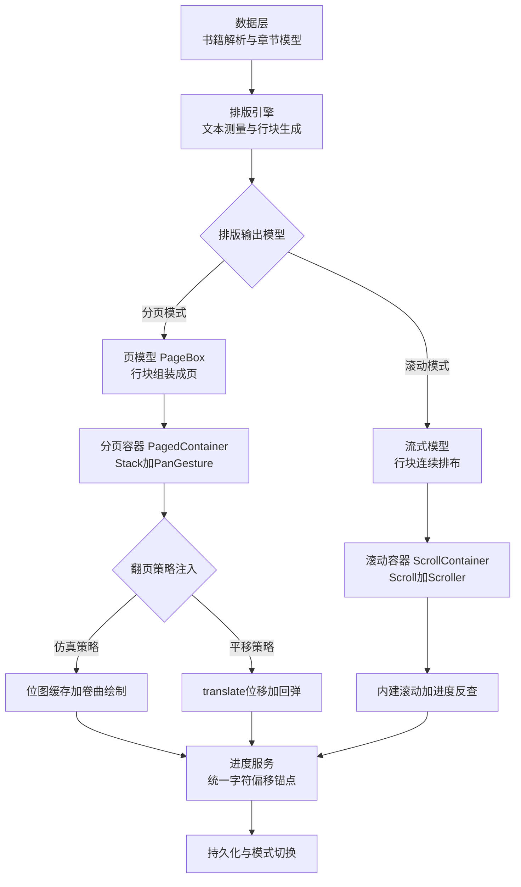
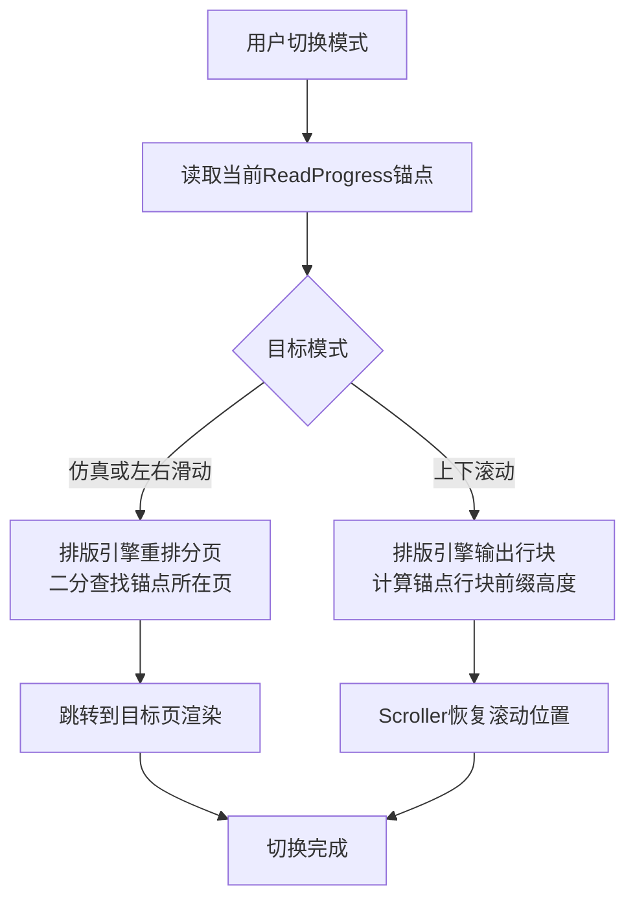

结论先行：**不需要三套独立逻辑，也不建议一套逻辑硬扛，推荐“一套阅读内核 + 两类内容容器 + 三个翻页策略”的分层设计**。三种模式在书籍解析、文本测量、排版、主题、进度管理等层面高度一致，真正的差异只集中在“排版输出模型”和“手势→视觉映射”两处，把这两处抽象成策略接口后，复用率可达七成以上。以下是完整设计文档。

---

# HarmonyOS 自研阅读器翻页架构设计文档

**目标环境**：API 24（Stage 模型，状态管理采用 V2 装饰器体系）
**支持模式**：仿真翻页、左右滑动、上下滚动

## 1. 复用性分析

先明确三种模式在各个维度的异同，这决定了架构的切分方式：

| 维度 | 仿真翻页 | 左右滑动 | 上下滚动 | 复用结论 |
|---|---|---|---|---|
| 书籍解析（txt/epub） | 相同 | 相同 | 相同 | 完全复用 |
| 文本测量（字号/行高/宽度） | 相同 | 相同 | 相同 | 完全复用 |
| 排版输出 | 固定尺寸页 | 固定尺寸页 | 整章流式行块 | **测量内核复用，输出模型分叉** |
| 手势交互 | 水平拖动 | 水平拖动 | 垂直滚动（容器内建） | 拖动型共用状态机，滚动型独立 |
| 翻页视觉 | 位图 + 卷曲绘制 | 位图/组件平移 | 无动效，容器滚动 | **三个策略各自实现** |
| 进度锚点 | 页 → 字符偏移 | 页 → 字符偏移 | 滚动偏移 → 字符偏移 | 统一为字符偏移锚点 |
| 主题/字体/菜单 | 相同 | 相同 | 相同 | 完全复用 |

由此得出架构原则：

1. **排版引擎输出统一的“行块”序列**：分页模式把行块组装成页，滚动模式把行块连续排布，测量逻辑只写一份。
2. **仿真与左右滑动共用一套拖动状态机**：两者都是“手指水平拖动 → 进度 → 视觉映射”，只是映射函数不同（卷曲 vs 平移）。
3. **上下滚动独立容器**：直接使用 Scroll 组件的内建手势与惯性，不要自己模拟滚动。
4. **进度统一用“章节 + 字符偏移”锚点**：任何模式都能换算，模式切换无损。

## 2. 总体架构



各层职责与依赖方向自上而下单向依赖，翻页策略以接口形式注入容器，容器不感知具体模式。

## 3. 核心数据模型与接口定义

```typescript
// reader/Model/ReaderModels.ets

// 阅读模式
export enum ReadMode {
  SIMULATION = 0, // 仿真翻页
  HORIZONTAL = 1, // 左右滑动
  VERTICAL = 2    // 上下滚动
}

// 统一进度锚点：任何模式都能换算为该结构
export interface ReadProgress {
  chapterIndex: number; // 章节序号
  charOffset: number;   // 章节内字符偏移
}

// 排版行块：排版引擎的最小输出单元
export interface LineBox {
  text: string;      // 该行文本
  charStart: number; // 行首字符在章节中的偏移
  charEnd: number;   // 行尾字符偏移（不含）
  lineHeight: number; // 行高，单位vp
}

// 页模型：分页模式的输出
export interface PageBox {
  lines: LineBox[];
  charStart: number;
  charEnd: number;
}

// 排版配置：字号、行距、页边距变化时触发重排
export interface LayoutConfig {
  fontSize: number;
  lineHeightRatio: number; // 行高倍率
  pagePadding: number;
  contentWidth: number;    // 内容区宽，vp
  contentHeight: number;   // 内容区高，vp
}
```

排版引擎接口（测量内核唯一，输出按需）：

```typescript
// reader/Engine/LayoutEngine.ets
export interface LayoutEngine {
  // 测量内核：把章节文本切成行块序列（两种模式共用）
  layoutLines: (chapterText: string, config: LayoutConfig) => LineBox[];
  // 分页输出：把行块组装成页（仿真/左右滑动用）
  buildPages: (lines: LineBox[], config: LayoutConfig) => PageBox[];
}
```

文本测量使用 MeasureUtils 的 measureTextSize，它计算指定文本在约束宽度下的宽高，返回值单位为 px，参数异常时返回 undefined 需判空<rsub ref="G.1.7">2</rsub>。注意避免与 ApplicationContext 的字体缩放设置同时使用，需自行监听字体缩放变化保证测量准确<rsub ref="G.1.7">2</rsub>。

翻页策略接口（仿真与左右滑动的差异点收敛于此）：

```typescript
// reader/Strategy/FlipStrategy.ets

// 拖动型策略的公共状态机回调
export interface FlipStrategy {
  // 手势开始：返回是否接管本次手势（如首屏边缘判定）
  onDragStart: (x: number, y: number) => boolean;
  // 拖动更新：dx为水平位移，返回当前视觉进度0~1
  onDragUpdate: (dx: number) => number;
  // 抬手：按进度与速度决定完成或回弹
  onDragEnd: (velocityX: number) => void;
  // 视觉渲染：容器每帧调用，progress由状态机驱动
  applyProgress: (progress: number) => void;
}
```

## 4. 容器层设计

### 4.1 分页容器（仿真 + 左右滑动共用）

```typescript
// reader/Container/PagedContainer.ets
@ComponentV2
struct PagedContainer {
  @Param mode: ReadMode = ReadMode.SIMULATION;
  @Param currentPage: PageBox | null = null;
  @Param nextPage: PageBox | null = null;
  @Event onFlipDone: (isNext: boolean) => void = () => {};
  private strategy: FlipStrategy | null = null;
  @Local flipProgress: number = 0; // 0未翻，1翻完

  aboutToAppear(): void {
    // 按模式注入策略：仿真策略内部做位图截图与卷曲绘制，
    // 平移策略内部只做translate位移，状态机完全一致
    this.strategy = FlipStrategyFactory.create(this.mode, this);
  }

  build() {
    Stack() {
      // 第1层：下一页内容（静止）
      PageContentView({ page: this.nextPage })
      // 第2层：当前页，视觉由策略驱动
      PageContentView({ page: this.currentPage })
        .translate({ x: this.strategy ? -this.flipProgress * 100 : 0 }) // 平移策略示例
      // 仿真策略时第2层替换为Canvas卷曲绘制，见策略实现
    }
    .gesture(
      PanGesture({ fingers: 1, direction: PanDirection.Horizontal })
        .onActionStart((event: GestureEvent) => {
          if (this.strategy) {
            this.strategy.onDragStart(event.fingerList[0].localX, event.fingerList[0].localY);
          }
        })
        .onActionUpdate((event: GestureEvent) => {
          if (this.strategy) {
            this.flipProgress = this.strategy.onDragUpdate(event.offsetX);
          }
        })
        .onActionEnd((event: GestureEvent) => {
          if (this.strategy) {
            this.strategy.onDragEnd(event.velocityX);
          }
        })
    )
  }
}
```

PanGesture 默认单指、任意方向触发，最小识别距离默认 5vp；direction 支持逻辑或运算组合方向<rsub ref="G.1.4">1</rsub>。分页容器限定 Horizontal 方向，与滚动模式的垂直手势天然不冲突。

### 4.2 滚动容器（上下滚动独立）

```typescript
// reader/Container/ScrollContainer.ets
@ComponentV2
struct ScrollContainer {
  @Param lines: LineBox[] = [];       // 整章行块，流式渲染
  @Param initialOffset: number = 0;   // 进入时恢复的滚动位置
  @Event onProgressChange: (offset: number) => void = () => {};
  private scroller: Scroller = new Scroller();

  build() {
    Scroll(this.scroller) {
      Column() {
        ForEach(this.lines, (line: LineBox, index: number) => {
          Text(line.text)
            .fontSize(18)
            .lineHeight(30)
            .width('100%')
        }, (line: LineBox, index: number) => index.toString())
      }
      .padding(16)
    }
    .scrollable(ScrollDirection.Vertical)
    .edgeEffect(EdgeEffect.Spring)
    .onDidScroll((xOffset: number, yOffset: number, state: ScrollState) => {
      // 滚动偏移反查行块，换算字符偏移进度
      this.onProgressChange(this.scroller.currentOffset().yOffset);
    })
  }
}
```

Scroll 组件内部已绑定手势实现跟手滚动与惯性，滚动时通过 onDidScroll 回调当前帧偏移量与滚动状态（Idle/Scroll/Fling）<rsub ref="G.1.5">3</rsub>。Scroller 控制器与滚动容器的绑定发生在组件创建阶段，绑定后才能调用其方法，在 aboutToAppear 中调用会因组件未创建而不生效，恢复滚动位置应放在 onAppear 回调中执行<rsub ref="G.1.3">4</rsub>。

## 5. 三个翻页策略实现要点

### 5.1 仿真策略（SimulationFlipStrategy）

沿用此前给出的完整设计：手势开始时通过 `this.getUIContext().getComponentSnapshot().get()` 把当前页与下一页截图为 PixelMap（注意截图返回最近一帧内容，时机放在手势开始时），拖动中用 Path2D 的 quadraticCurveTo 构造卷曲路径逐帧重绘，抬手后按进度用 `this.getUIContext().animateTo()` 补间完成或回弹。

### 5.2 平移策略（HorizontalFlipStrategy）

与仿真策略共用同一状态机，仅 applyProgress 的映射不同：

```typescript
// 进度到视觉的映射：整页平移，无卷曲
applyProgress(progress: number): void {
  // 容器层读取progress驱动translate：当前页左移 progress * pageWidth
  // progress < 0 时表示回翻上一页，方向取反
}
```

性能上平移策略可以完全不走位图，直接对两个内容组件做 translate，比仿真策略轻量得多。

### 5.3 滚动模式（无策略，容器内建）

不需要 FlipStrategy，滚动、惯性、回弹全部由 Scroll 内建能力承担，策略层的工作只剩“滚动偏移 → 字符偏移”的反查：维护行块高度前缀和数组，用二分查找把 yOffset 定位到行块，再取 line.charStart 得到进度锚点。

## 6. 进度模型与模式切换

统一锚点 `ReadProgress`（章节 + 字符偏移）是三种模式互通的桥梁：



要点：

1. 分页模式下页码只是派生值，持久化只存字符偏移，字号调整导致重排后进度不丢。
2. 模式切换必须先完成目标模式排版再切换容器，避免出现空白帧。
3. 切换期间冻结手势，防止排版未完成时误触发翻页。

## 7. 性能设计

| 项 | 措施 |
|---|---|
| 排版耗时 | 大章节排版放 TaskPool 子线程，行块序列通过 Sendable 容器回传主线程 |
| 页面缓存 | 分页模式只保留当前页 ±1 的位图/组件，翻页完成后异步预渲染邻页 |
| 滚动渲染 | 滚动模式行块用 LazyForEach 按需加载，避免整章组件一次性创建 |
| 测量缓存 | measureTextSize 结果按（字号， 行宽， 文本段）缓存，重排时增量测量 |
| 仿真帧率 | 卷曲绘制每帧只重建 Path 与重绘位图，不触碰文本排版；低端机可降级为平移策略 |

## 8. 工程结构建议

```text
reader/
├── Model/          // ReadMode、ReadProgress、LineBox、PageBox
├── Data/           // 书籍解析、章节加载
├── Engine/         // LayoutEngine（测量内核 + 两种输出）
├── Strategy/       // FlipStrategy接口 + 仿真/平移两个实现
├── Container/      // PagedContainer + ScrollContainer
├── Service/        // 进度服务、主题服务、持久化
└── View/           // ReadPage入口、菜单、设置面板
```

实施顺序建议：先做排版引擎与滚动容器（最快可用），再做平移策略（状态机 + translate），最后做仿真策略（位图 + 卷曲），每一步都可独立验收。

## 9. 风险点提示

1. **measureTextSize 与 Text 组件渲染的一致性**：测量用的约束宽度、字号、行高必须与实际渲染的 Text 属性完全一致，否则分页边界与显示内容错位；建议字号等参数统一从 LayoutConfig 单点下发。
2. **滚动模式的首行偏移**：恢复进度时需考虑页边距与首行缩进，前缀高度计算要把 padding 计入。
3. **仿真策略的截图时机**：截图返回最近一帧绘制内容，若在手势开始瞬间页面尚未完成渲染，需等待一帧再截图，否则卷曲的是旧内容。
4. **V1/V2 装饰器不可混用**：全部组件统一采用 @ComponentV2 体系，@Local 必须本地初始化，跨组件回调用 @Event 声明。

---

需要的话，我可以继续展开其中任何一块的完整代码实现，比如排版引擎的分页算法（含标点避头尾、段落缩进处理），或者仿真策略的卷曲绘制完整实现。
内容由 AI 生成，仅供参考